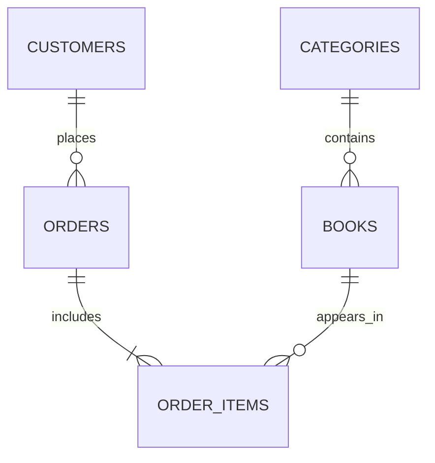

# BookNest — Bookstore Management System

BookNest is a relational database application for managing a small bookstore.
It supports book inventory, categories, customers, orders, and a sales dashboard.

## Technologies

| Component | Technology |
|---|---|
| Programming language | Python |
| Backend framework | Flask |
| Database | SQLite |
| Frontend | HTML, CSS, JavaScript |
| Templates | Jinja |
| Database access | Python sqlite3 module |

## Features

- Add, view, edit, and delete books.
- Add, view, edit, and delete categories.
- Add, view, edit, and delete customers.
- Create orders containing multiple books.
- Automatically reduce stock when an order is placed.
- Cancel orders and restore stock.
- Prevent cancelling the same order twice.
- Reject orders when stock is insufficient.
- Prevent duplicate ISBNs and customer emails.
- Protect records referenced by other tables.
- Show inventory, customer, order, and sales totals.
- Display low-stock alerts.
- Exclude cancelled orders from sales totals.

## Project Files

| File | Purpose |
|---|---|
| app.py | Flask pages, validation, and backend APIs |
| database.py | Database connection and initialization |
| schema.sql | Relational table definitions and constraints |
| seed.py | Fictional sample data |
| requirements.txt | Python dependencies |
| templates/index.html | Book inventory and CRUD |
| templates/categories.html | Category management |
| templates/customers.html | Customer management |
| templates/orders.html | Order creation and cancellation |
| templates/dashboard.html | Store totals and low-stock alerts |
| .gitignore | Excludes generated and local files |

## Database Design

The database contains five tables:

| Table | Primary Key | Foreign Keys | Purpose |
|---|---|---|---|
| categories | id | None | Book categories |
| books | id | category_id | Book details, prices, and available stock |
| customers | id | None | Customer details |
| orders | id | customer_id | Order date, customer, and status |
| order_items | id | order_id, book_id | Books and quantities in each order |

### Relationships



An order must contain at least one item; the backend enforces this rule.

### Database Rules

- Category names are unique.
- Book ISBNs or book codes are unique.
- Customer emails are unique.
- Stock and prices cannot be negative.
- Order item quantities must be positive.
- Each book appears at most once within an order.
- Foreign keys are enabled on every application database connection.
- Records used by related records cannot be deleted.

### Normalization

Categories, books, customers, orders, and order items are stored separately.

Customer details are not repeated in every order.
Category names are not repeated in every book record.
The order_items table connects orders and books, allowing multiple books
in one order without repeated book columns.

### Money and Historical Prices

Prices are stored as integer cents.
For example, $15.99 is stored as 1599.

Each order item stores the unit price charged when the order was created.
Changing a book's current price does not change previous order totals.

### Transactions

Order creation and cancellation use database transactions.

Creating an order saves the order, saves its items, and reduces stock together.
If the operation fails, unfinished changes are rolled back.

Cancellation restores stock and updates the order status together.
A cancelled order cannot be cancelled again.

## Setup Instructions — Windows

### Requirements

- Python installed and accessible using the `py` command.
- Internet access for installing dependencies.
- The project downloaded or cloned from GitHub.

### 1. Open the project folder

Download the repository as a ZIP and extract it, or clone it using Git.

Open a terminal inside the folder containing app.py.

### 2. Create a virtual environment

```powershell
py -m venv .venv
```

### 3. Install dependencies

```powershell
.\.venv\Scripts\python.exe -m pip install -r requirements.txt
```

These commands use the virtual environment directly, so activation is optional.

### 4. Create the database

```powershell
.\.venv\Scripts\python.exe database.py
```

This creates booknest.db using schema.sql.

### 5. Load sample data

```powershell
.\.venv\Scripts\python.exe seed.py
```

The sample data contains:

- 3 categories.
- 5 books.
- 3 fictional customers.
- No initial orders.

The seed script skips existing records with matching unique fields.
It does not reset edited stock or existing orders.

### 6. Start the application

```powershell
.\.venv\Scripts\python.exe -m flask --app app run
```

### 7. Open the website

Open this address in a browser:

http://127.0.0.1:5000/dashboard

Keep the terminal running while using the application.
Press Ctrl+C in the terminal to stop it.

## Pages

| Page | Address |
|---|---|
| Dashboard | /dashboard |
| Books | / |
| Categories | /categories |
| Customers | /customers |
| Orders | /orders |

## API Endpoints

| Method | Endpoint | Purpose |
|---|---|---|
| GET | /api/books | List books |
| POST | /api/books | Add a book |
| PUT | /api/books/<id> | Update a book |
| DELETE | /api/books/<id> | Delete an unused book |
| GET | /api/categories | List categories |
| POST | /api/categories | Add a category |
| PUT | /api/categories/<id> | Update a category |
| DELETE | /api/categories/<id> | Delete an unused category |
| GET | /api/customers | List customers |
| POST | /api/customers | Add a customer |
| PUT | /api/customers/<id> | Update a customer |
| DELETE | /api/customers/<id> | Delete a customer without orders |
| GET | /api/orders | List order summaries |
| POST | /api/orders | Create an order |
| POST | /api/orders/<id>/cancel | Cancel an order |

Replace <id> with the record's numeric ID.

### Example: Create a Book

POST /api/books

```json
{
  "title": "My First Python Book",
  "author": "Suma",
  "isbn": "DEMO-001",
  "category_id": 1,
  "price": "15.99",
  "stock": 10
}
```

Use an existing category ID and a unique book code.

### Example: Create an Order

POST /api/orders

```json
{
  "customer_id": 1,
  "items": [
    {
      "book_id": 1,
      "quantity": 2
    },
    {
      "book_id": 2,
      "quantity": 1
    }
  ]
}
```

Use existing customer and book IDs.

The backend reads prices from the database and calculates the total.
It does not accept a browser-supplied order total.

## Manual Test Checklist

| Test | Expected Result |
|---|---|
| Add a book | Book appears in inventory |
| Edit a book | Updated details appear |
| Delete an unused book | Book is removed |
| Add duplicate ISBN | Request is rejected |
| Submit negative price or stock | Request is rejected |
| Add and edit a category | Category details are saved |
| Delete an unused category | Category is removed |
| Delete a category containing books | Request is rejected |
| Add and edit a customer | Customer details are saved |
| Add duplicate customer email | Request is rejected |
| Delete a customer with orders | Request is rejected |
| Order two different books | Both books are saved in one order |
| Place an order | Stock decreases by ordered quantities |
| Order more than available stock | Request is rejected |
| Cancel an order | Stock is restored |
| Cancel an order again | Request is rejected |
| View dashboard sales | Cancelled orders are excluded |
| Restart Flask | Previously saved data remains |

## Classroom Demonstration

1. Open the dashboard.
2. Add a book and edit its price.
3. Show category and customer management.
4. Add two different books to an order.
5. Place the order.
6. Show that both stock quantities decreased.
7. Cancel the order.
8. Show that stock was restored.
9. Explain the five tables and their foreign keys.
10. Explain why order changes use transactions.

## Troubleshooting

### TemplateNotFound

Check that all five HTML files are inside the templates folder
and that their filenames match the names used in app.py.

### No such table

Run database.py before starting Flask.

### Method Not Allowed — 405

Check that the required API route exists in app.py.
Save the file and restart Flask.

### Unexpected token '<' / Invalid JSON

The server returned HTML instead of JSON.
Check the HTTP status and error output in the Flask terminal.

### Address already in use

Stop the existing Flask process with Ctrl+C before starting another one.

## Scope and Limitations

This is a local classroom demonstration application.

It does not include authentication, online payments, delivery tracking,
or production deployment configuration.

Customer email validation is basic.
The dashboard refreshes when its page is loaded.
Orders are retained as history and cancelled rather than deleted.

## Future Improvements

- User login and roles.
- Book search and filtering.
- Individual order detail pages.
- Sales charts and CSV export.
- Shared templates and a separate stylesheet.
- Production deployment.

## Development Resources

- Flask documentation: https://flask.palletsprojects.com/
- Python documentation: https://docs.python.org/3/
- SQLite documentation: https://www.sqlite.org/docs.html

AI assistance was used during development.
The implementation should be reviewed and understood by the presenter.